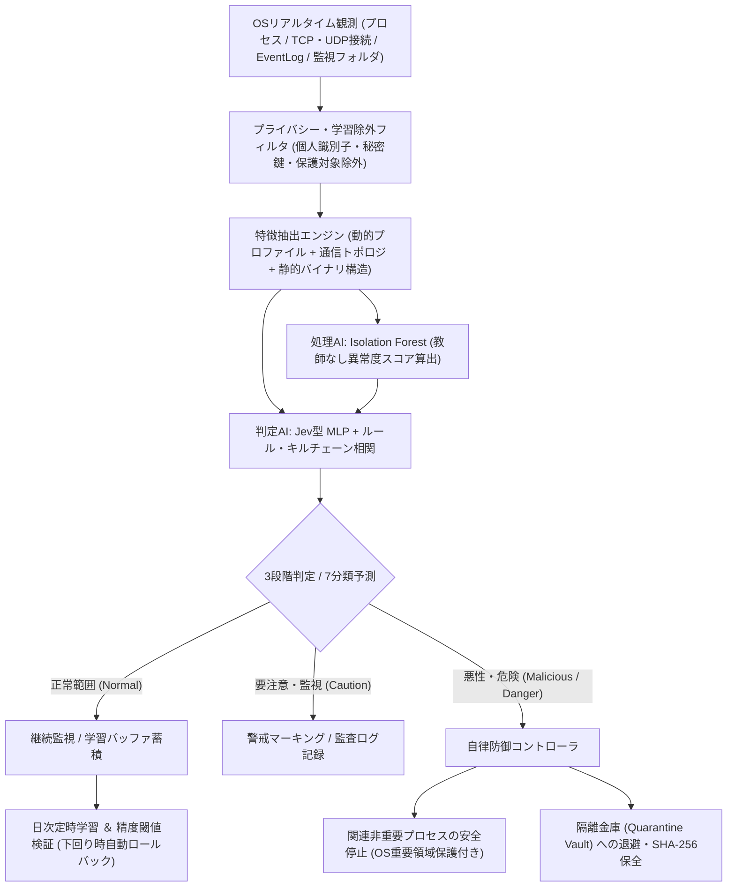
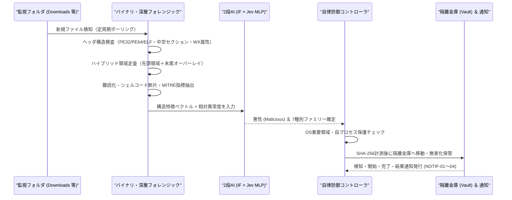

# 自律型サイバーAI防御システム — アーキテクチャ＆セキュリティ白書 (Architecture Overview)

本書は、CISO / CTO・情報システム管理者・セキュリティ研究者向けに、本システム（完全ローカル完結型・非言語AI自律防御エンジン）の内部アーキテクチャ、脅威検知メカニズム、および監査証跡の改ざん耐性を解説する技術白書です。

> **設計原則（IP保護および耐回避性）**
> 攻撃者によるホワイトボックス解析（閾値逆算・回避ペイロード生成）および独自AIパラメータの流出を防ぐため、具体的な数値閾値・モデル重み行列・内部定数・ソースコード実装の公開は行いません。本書ではシステム構造・判定ロジックの枠組み・MITRE ATT&CK 対応体系を記載します。

---

## 1. 完全ローカル 2段AIパイプライン構造

本システムは外部のクラウドAPIや会話型LLMを一切利用せず、ネイティブコード（Rust）上に実装された軽量な数値AIを2段階で連携させてリアルタイム判定を実現します。

### AI コンポーネント間の役割分担

| レイヤー | 役割 | 採用方式 | 外部API依存 |
| :--- | :--- | :--- | :--- |
| **処理AI (Main AI)** | 多次元挙動・静的特徴からの異常度定量化 | 教師なし **Isolation Forest** ＋ 通信トポロジ・バイナリ構造解析 | なし（100%ローカル） |
| **判定AI (Judge AI)** | 異常スコアと固有指標を組み合わせた最終リスク分類 | **Jev型 多層パーセプトロン (MLP)** ＋ 決定論的キルチェーン相関 | なし（100%ローカル） |
| **自律学習・補正系** | 端末利用環境への適応と精度劣化ガード | プライバシー除外後の日次バッチ学習 ＋ 閾値未満時の自動ロールバック | なし（100%ローカル） |

---

## 2. 境界防御に頼らない深層フォレンジックと自律隔離

見かけ上の「プロセス名」や「ファイル拡張子」のホワイトリストに頼らず、通信トポロジとバイナリ構造の不整合を多層で解析します。

### 対応する主な脅威フレームワーク（MITRE ATT&CK マッピング）

| 分類・戦術 | MITRE ID | 検知対象となる典型的攻撃手口 |
| :--- | :--- | :--- |
| **拡張子偽装（Masquerading）** | `T1036` | 文書・メディア拡張子（`.pdf`, `.txt` 等）の背後に実体としての PE/ELF 実行ヘッダや二重拡張子を隠蔽する偽装検体 |
| **難読化・パッカー・中空構造** | `T1027` / `T1027.002` | 高密度シンボル難読化、動的文字コード変換、シェルコード断片、生データサイズ0で展開領域を持つ中空実行セクション、ファイル末尾オーバーレイ隠蔽 |
| **防衛回避（Defense Evasion）** | `T1562` | AMSI / ETW 無効化、セキュリティ対策機構のリアルタイム監視停止コマンド |
| **実行・ドロッパー・LOLBins** | `T1059.001` / `T1105` / `T1218` | 隠し実行スクリプト、外部ペイロード取得、正規OS管理バイナリの悪用 |
| **プロセス注入・C2通信** | `T1055` / `T1071` | 外部プロセスメモリ確保・書込・リモートスレッド生成、リバースシェル／異常C2ポート待受・確立通信 |
| **認証情報・ウォレット窃取** | `T1003` / `T1555` / `T1056` | LSASS メモリダンプ手口、ブラウザ資格情報DB・暗号資産ウォレット参照、キーロガーフック |
| **ランサムウェア** | `T1490` / `T1486` | シャドウコピー・バックアップ削除によるリカバリ阻害、暗号化API連続利用および身代金要求 |
| **横展開・リソース不正利用** | `T1021` / `T1570` / `T1496` | 管理共有・リモート実行サービスを介した拡散手口、マイニングプール通信プロトコル |

---

## 3. SHA-256 ハッシュチェーンによる改ざん検知付き監査証跡

すべての監視更新・AI判定・定義照合・自律隔離・復元・設定変更イベントは、各レコードが直前のハッシュ値を参照して連結する暗号学的ハッシュチェーン構造で記録されます。

- **二重起動および外部書換の抑止**: 起動時に監査ログへの排他ファイルロックを取得し、他プロセスからの無断変更や多重インスタンスによるログ破損を防止します。
- **改ざんの即時検出**: 1行の削除・改変・ID重複・順序入れ替えが発生しても、チェーン全体の再計算により不整合箇所（`brokenAtId`）を即座に特定します。
- **プライバシー境界の厳守**: 監査ログには操作サマリ・分類結果・ハッシュ情報のみを安全に記録し、個人経路や機密文字列、生データ本文を混入させません。

---

## 4. 利用環境改善・静的コード監査エンジン

端末の稼働姿勢（自動防御設定の有効化、全インターフェース待受リスクポートの監視状態）および開発・運用環境の健全性を総合評価し、S〜D グレードでの診断とワンクリック設定改善アクションを提供します。

---

*Copyright (c) 2026 NEXSPACE. All rights reserved.*
